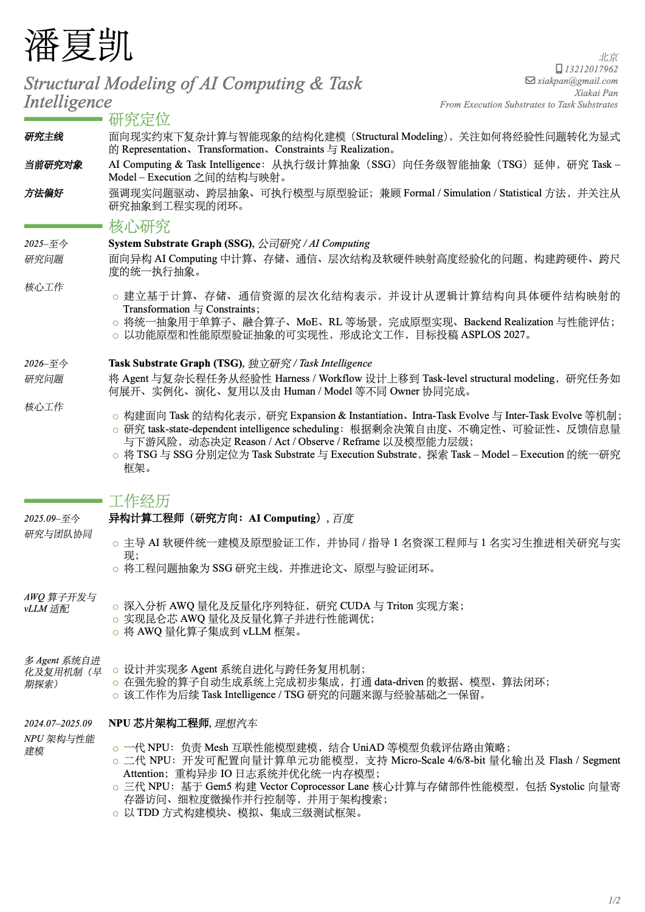

# Xiakai Pan (潘夏凯)

**AI Systems Research · Computer Architecture · Compiler/Runtime · Agent Systems**

[Research Statement](/statement/) · [Research](/research/) · [Publications](/publications/) · [GitHub](https://github.com/XiakaiPan)

Contact: [xiakpan@gmail.com](mailto:xiakpan@gmail.com)

## Research Interests

Structural modeling, representation and transformation for heterogeneous AI computing; workload/system scheduling, compilers and performance modeling; long-horizon Agent execution; formal task evolution.

## Selected Research

### SSG — System Substrate Graph

Workload–System–Schedule representation and Build–Traverse–Translate mechanism for heterogeneous AI execution, including operators, training/inference/RL, and Agent/tool/model workloads. The former Agent-SSG work is integrated into SSG; it is **not** a separate current paper. A [2026 SSG Technical Report — author edition](/assets/papers/ssg/author-2026-11/ssg-technical-report-2026-11.pdf) (not peer-reviewed) reports bounded H20 and 8×A800 results and negative correctness/fallback evidence. Later generalizations require separate validation.

### TSG — Task Substrate Graph

Formal study of persistent, evolving human–AI tasks using Actor × Spec × Impl, semantic context, activity-relative Component/Model/Artifact roles and intra-/inter-task evolution. [2026 self-hosted preprint](/assets/papers/tsg/v0.1/tsg-preprint-v3.1.13.pdf); evaluation and semantic questions remain open.

### SSG-DT — Predictive Execution Modeling

Research direction on structure-preserving cost/simulation models over selected SSG execution plans. Design and evaluation protocol available; no validated twin results claimed. My [Three Models](/research/three-models/) note discusses formal, simulation and statistical modeling roles.

## Peer-reviewed Publication

Chen Li, **Xiakai Pan**, et al. *Style Adaptation module: Enhancing detector robustness to inter-manufacturer variability in surface defect detection.* **Computers in Industry** (2024). [DOI](https://doi.org/10.1016/j.compind.2024.104084).

## Research and Professional Experience

### Baidu — Heterogeneous Computing Engineer
**September 2025 – Present**

- GPU/NPU inference execution infrastructure, operator implementation and runtime adaptation.
- Accelerator operator integration with vLLM, including AWQ-related work.
- Research prototypes for cross-scale execution representation and scheduling.

### Li Auto — NPU Architecture and Modeling Engineer
**July 2024 – September 2025**

- Accelerator functional/performance modeling; on-chip interconnect, vector computing and memory hierarchy studies.
- gem5-based exploration, workload-aware hardware/software co-design, and compiler/runtime integration.

### Borui Jingxin — NPU Architecture Modeling Intern
**November 2023 – January 2024**

NVDLA-oriented simulation infrastructure and model integration.

### PLCT Lab — RISC-V Virtualization Research Intern
**July 2022 – January 2023**

RISC-V hypervisor extensions, KVM/QEMU/Spike, and a [ten-article technical series on RISC-V virtualization](/writing/) published on TinyLab in 2023.

## Education

**Tsinghua University** — M.S., Data Science and Information Technology, 2021–2024; computer architecture, CPU simulation and industrial vision.

**Nankai University** — B.S., Chemistry, 2017–2021; additional study in Chinese language and literature and experience in machine learning.

## Technical Writing

**RISC-V Virtualization: 10 technical articles**, TinyLab / 泰晓科技 (2023). Covers privilege transitions, Host/Guest boot, memory virtualization, KVM userspace, exception/interrupt handling, and Spike/QEMU/kvmtool implementations. [Complete series and original links](/writing/).

## Technical Skills

C/C++ · Python · CUDA/Triton · GPU/NPU operators · TVM/MLIR/XLA · vLLM · gem5/SST/QEMU/Spike · functional/performance modeling · AI inference and distributed scheduling.

---

*Updated November 2026. Statements of research scope do not imply completed implementation. Experimental figures are attributed to the linked manuscript and have not been independently reproduced for this website.*

## PDF version

The complete CV is also available as a typeset PDF. Click the preview to open it.

<figure class="hero-figure">
  
  <figcaption><strong>Curriculum Vitae</strong> &middot; 2 pages, Chinese &middot; <a href="/assets/cv/xiakai-pan-cv.pdf">Open PDF &nearr;</a></figcaption>
</figure>

The PDF omits the telephone number; use the contact address above.
