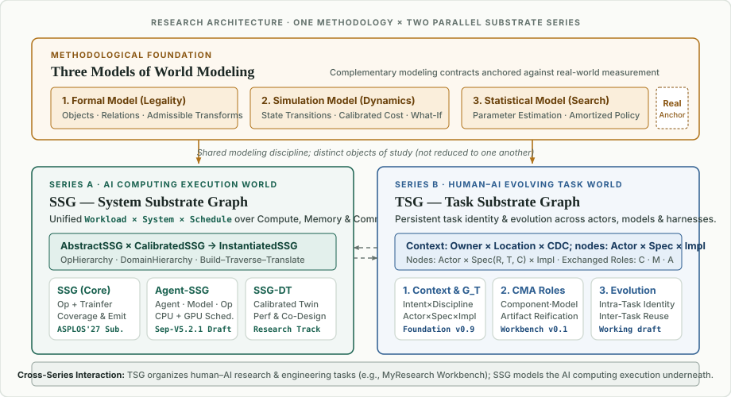

# Xiakai Pan (潘夏凯)

**AI Computing & Task Intelligence** · *Structural modeling from execution substrates to evolving task substrates.*

I work on computer architecture, AI infrastructure, compilers, and runtime systems. My research investigates how implicit structure in **AI computing execution** and **long-horizon human–AI work** can be turned into explicit, checkable substrate graphs—connecting one methodological foundation (**Three Models**) with two parallel research series (**SSG** and **TSG**).

  Quick Jump
  <a class="btn-pill primary" href="#featured-manuscripts-and-direct-pdfs">Featured Manuscripts &amp; PDFs &darr;</a>
  <a class="btn-pill" href="/research/three-models/">Three Models</a>
  <a class="btn-pill" href="/research/ssg/">SSG Series</a>
  <a class="btn-pill" href="/research/tsg/">TSG Series</a>
  <a class="btn-pill" href="/publications/">Publications</a>
  <a class="btn-pill" href="/cv/">CV</a>

<figure class="hero-figure">
  
  <figcaption><strong>Figure 1 · Overall Research Program.</strong> <em>Three Models</em> (Formal · Simulation · Statistical, anchored against real measurement) provides the shared modeling methodology. <strong>Series A (SSG)</strong> models the AI computing execution world across operators, training/inference/RL, and agents; <strong>Series B (TSG)</strong> models the evolving human–AI task world across actors, specifications, implementations, and activity-relative CMA objects.</figcaption>
</figure>

## Research Program at a Glance

  

    

      
Methodological Foundation

      <h3><a href="/research/three-models/">Three Models of World Modeling</a></h3>
      
<strong>Formal · Simulation · Statistical</strong> contracts anchored against external measurement: Formal defines legal structure, Simulation evaluates dynamics and cost, and Statistical amortizes calibration and search.

    

    

      <a class="btn-pill" href="/research/three-models/">Methodology Page &rarr;</a>
      <a class="btn-pill" href="/research/three-models/#barycentric-prototypes-in-ssg-and-tsg">Barycentric Map &rarr;</a>
    

  

  

    

      
Series A · AI Computing World

      <h3><a href="/research/ssg/">SSG — System Substrate Graph</a></h3>
      
Unified <code>Workload / System / Schedule</code> representation across compute, memory, and communication—spanning Operators (T1), Trainfer/RL (T2), and Heterogeneous Agent workflows (T3).

    

    

      <a class="btn-pill primary" href="/assets/papers/ssg/v0.1/ssg-asplos27-v2.4.7.pdf">SSG PDF (Sep-V2.4.7) &nearr;</a>
      <a class="btn-pill" href="/research/ssg/">SSG</a>
      <a class="btn-pill" href="/research/agent-ssg/">Agent-SSG</a>
      <a class="btn-pill" href="/research/ssg-dt/">SSG-DT</a>
    

  

  

    

      
Series B · Human–AI Task World

      <h3><a href="/research/tsg/">TSG — Task Substrate Graph</a></h3>
      
Persistent and evolving task structures situated by <code>Owner &times; Location &times; Operation(CDC)</code>, decoupling graph nodes (<code>Actor &times; Spec &times; Impl</code>) from exchanged <code>Component · Model · Artifact</code> roles.

    

    

      <a class="btn-pill primary" href="/assets/papers/tsg/v0.1/tsg-preprint-v3.1.13.pdf">Historical TSG PDF (Sep-V3.1.13) &nearr;</a>
      <a class="btn-pill" href="/research/tsg/">TSG Overview</a>
      <a class="btn-pill" href="/research/tsg/#historical-lineage-tli-and-workbench-to-tsg">3 Manuscripts &rarr;</a>
    

  

## Featured Manuscripts and Direct PDFs

*Working manuscripts and submission snapshots are linked directly below with version tags and provenance. Unaccepted manuscripts are explicitly distinguished from peer-reviewed publications.*

  

    SSG: A Unified System Substrate Graph for Cross-Scale AI Computing
    ASPLOS'27 Submission Snapshot · Sep-V2.4.7
  

  

    <strong>Scope:</strong> Cross-scale representation with independent <code>AbstractSSG</code> (Workload) and <code>CalibratedSSG</code> (System) inputs bound into <code>InstantiatedSSG</code>, bounded strategy enumeration, and executable realization across GPU operators (GEMM, GQA, MoE) and distributed Trainfer workloads.
  

  

    <a class="btn-pill primary" href="/assets/papers/ssg/v0.1/ssg-asplos27-v2.4.7.pdf">Download PDF (Sep-V2.4.7) &nearr;</a>
    <a class="btn-pill" href="/research/ssg/#manuscripts-and-artifacts">Paper Details &amp; Abstract &rarr;</a>
    <a class="btn-pill" href="/research/ssg/#version-history">Version Lineage &rarr;</a>
  

  

    Task Substrate Graph: Representing Persistent and Evolving Task Structure
    Current draft: 2026.10.4.3.1 · Historical PDF: Sep-V3.1.13
  

  

    <strong>Current draft (28 October 2026):</strong> Domain-independent representation of persistent task identity, <code>Actor &times; Spec(R,T,C) &times; Impl</code> structural factorization, activity-relative CMA roles, and <code>Intra-Task</code> vs. <code>Inter-Task</code> evolution.
  

  

    <a class="btn-pill primary" href="/assets/papers/tsg/v0.1/tsg-preprint-v3.1.13.pdf">Historical Foundation PDF (Sep-V3.1.13) &nearr;</a>
    <a class="btn-pill" href="/assets/papers/tsg/v0.1/tsg-preprint-v3.1.14-source.tar.gz">Sep-V3.1.14 TeX Source (.tar.gz) &nearr;</a>
    <a class="btn-pill" href="/assets/papers/tsg/v0.1/tli-aug-v4.2.pdf">TLI Draft PDF (Aug-V4.2) &nearr;</a>
    <a class="btn-pill" href="/assets/papers/tsg/v0.1/workbench-aug-v0.1.pdf">Workbench PDF (Aug-V0.1) &nearr;</a>
    <a class="btn-pill" href="/research/tsg/#historical-lineage-tli-and-workbench-to-tsg">TSG Paper Suite &rarr;</a>
  

  

    Agent-SSG: Cross-Layer Scheduling of Agent Workflows on Heterogeneous AI Systems
    Working Draft Snapshot · Sep-V5.2.1 (Archived Line)
  

  

    <strong>Current draft:</strong> <code>2026.10.4.3.1</code> (28 October 2026) proposes dynamically revealed workloads, effect-aware tool overlap, model/operator refinement, and traceable dispatch. Results remain pending; the linked September PDF is historical.
  

  

    <a class="btn-pill primary" href="/assets/papers/agent-ssg/v0.1/agent-ssg-mlsys27-v5.2.1.pdf">Download Draft PDF (Sep-V5.2.1) &nearr;</a>
    <a class="btn-pill" href="/research/agent-ssg/#architecture-l0-l1-l2-on-heterogeneous-substrates">Agent-SSG Details &rarr;</a>
  

---

**Research areas:** AI Systems · Compiler/Runtime · Heterogeneous Scheduling · Computer Architecture · Agent Systems

[Research](/research/) · [Publications](/publications/) · [Writing](/writing/) · [CV](/cv/) · [GitHub](https://github.com/XiakaiPan)

