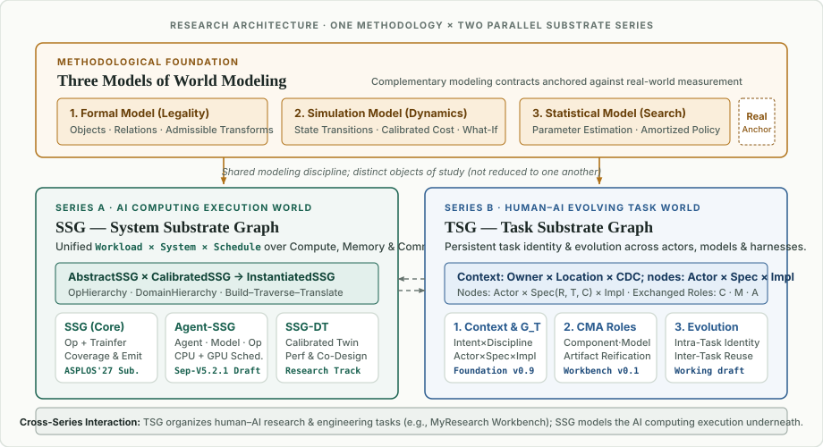
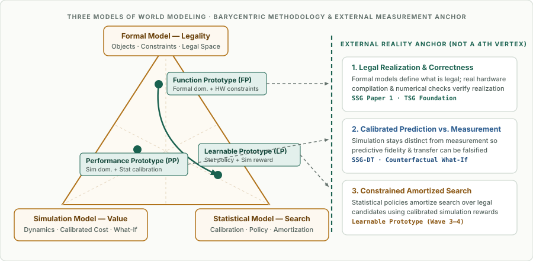
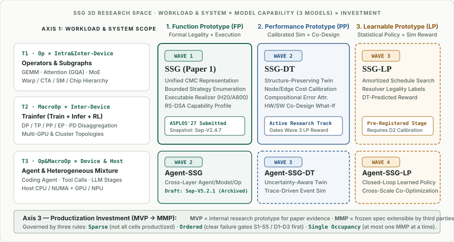
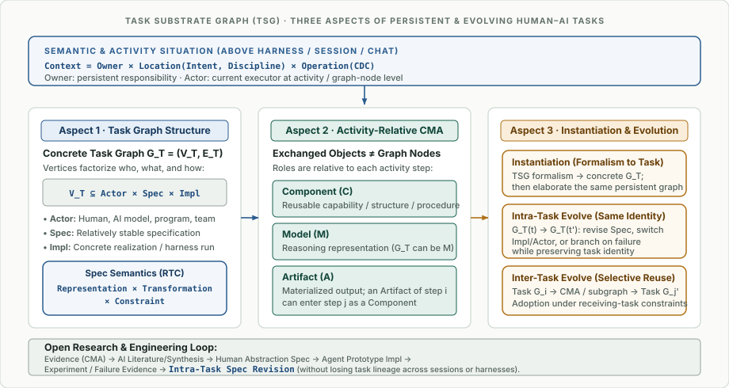

# Research

My research investigates how **implicit structure** in AI computing execution and human–AI collaborative work can become **explicit substrate representations** for implementation, analysis, and evolution.

The program connects one methodological foundation (**[Three Models](/research/three-models/)**) with two parallel research series (**[SSG](/research/ssg/)** for the AI computing world and **[TSG](/research/tsg/)** for the evolving task world).

  On This Page
  <a class="btn-pill primary" href="#manuscript-and-artifact-index">Manuscript &amp; PDF Index &darr;</a>
  <a class="btn-pill" href="#foundation-three-models-of-world-modeling">1. Three Models</a>
  <a class="btn-pill" href="#series-a-system-substrate-graph-ssg">2. Series A: SSG</a>
  <a class="btn-pill" href="#series-b-task-substrate-graph-tsg">3. Series B: TSG</a>

<figure class="hero-figure">
  
  <figcaption><strong>Figure 1 · Architectural Map of the Research Program.</strong> SSG and TSG are parallel in scope—one models execution substrates (Compute, Memory, Communication), while the other models persistent task substrates (<code>Actor &times; Spec &times; Impl</code> and <code>CMA</code>). Both draw on the <em>Three Models</em> methodology without reducing one domain to the other.</figcaption>
</figure>

## Manuscript and Artifact Index

For quick access, all compiled working manuscripts, preprint candidates, and research pages are indexed here:

| Series / Track | Working Title / Scope | Current Version & Status | Direct Manuscript / Page |
|---|---|---|---|
| **Foundation** | *Three Models of World Modeling* (Formal · Simulation · Statistical + Measurement Anchor) | Methodology framework (integrated into SSG Roadmap v1.5.2 & TSG) | [Three Models Page](/research/three-models/) |
| **Series A · SSG** | *SSG: A Unified System Substrate Graph for Cross-Scale AI Computing* | **Sep-V2.4.7** · ASPLOS'27 submission snapshot (11p + appendices) | **[PDF (Sep-V2.4.7)](/assets/papers/ssg/v0.1/ssg-asplos27-v2.4.7.pdf)** · [SSG Page](/research/ssg/) |
| **Series A · Agent-SSG** | *Agent-SSG: Cross-Layer Scheduling of Agent Workflows on Heterogeneous AI Systems* | **Sep-V5.2.1** · Working draft snapshot (archived paper line) | **[PDF (Sep-V5.2.1)](/assets/papers/agent-ssg/v0.1/agent-ssg-mlsys27-v5.2.1.pdf)** · [Agent-SSG Page](/research/agent-ssg/) |
| **Series A · SSG-DT** | *SSG-DT: Structure-Preserving Performance Modeling and Digital Twin* | Wave 2 active research track (calibrated cost & transfer) | [SSG-DT Page](/research/ssg-dt/) |
| **Series B · TSG (Core)** | *Task Substrate Graph: Representing Persistent and Evolving Task Structure* | **Sep-V3.1.14** · arXiv submitted (`8122073`, 29p, 3 figs, 24 refs) | **[PDF (Sep-V3.1.13)](/assets/papers/tsg/v0.1/tsg-preprint-v3.1.13.pdf)** · **[TeX Source (1.14)](/assets/papers/tsg/v0.1/tsg-preprint-v3.1.14-source.tar.gz)** · [TSG Page](/research/tsg/) |
| **Series B · TLI Lineage** | *Task-Level Intelligence: Task Substrate Graphs for Recursive Intelligent Creation* | **Aug-V4.2** · Extended 17-section theory checkout | **[PDF (Aug-V4.2)](/assets/papers/tsg/v0.1/tli-aug-v4.2.pdf)** · [TSG Lineage](/research/tsg/#version-history) |
| **Series B · Workbench** | *Toward an AI-Native Workbench: Unifying Consume, Digest, and Create* | **Aug-V0.1** · Systems position draft (35 sections) | **[PDF (Aug-V0.1)](/assets/papers/tsg/v0.1/workbench-aug-v0.1.pdf)** · [TSG Lineage](/research/tsg/#version-history) |

---

## Foundation — Three Models of World Modeling

**Formal · Simulation · Statistical (anchored against external Measurement)**

<figure class="hero-figure">
  
  <figcaption><strong>Figure 2 · The Method Triangle &amp; External Measurement Anchor.</strong> Formal decides what is legal; Simulation decides what is good; Statistical decides how to find it. Engineering prototypes occupy interior barycentric points (FP &rarr; PP &rarr; LP), all audited against real hardware/empirical measurement outside the triangle.</figcaption>
</figure>

- **Formal models (Legality):** Explicit objects, relations, invariants, and admissible transformations.
- **Simulation models (Value & Dynamics):** State transitions, calibrated cost models, and counterfactual interventions.
- **Statistical models (Search & Amortization):** Parameter estimation from observations and learned policies over legal spaces.

[Explore Three Models methodology &rarr;](/research/three-models/)

---

## Series A — System Substrate Graph (SSG)

**Modeling the execution world of AI computing**

SSG studies a unified representation for **Workload, System, and Schedule** built on Compute, Memory, and Communication (CMC). Rather than treating operator compilers, distributed training/inference frameworks, and agent runtimes as separate worlds, SSG factorizes them along a **3D research space**:

<figure class="hero-figure">
  
  <figcaption><strong>Figure 3 · SSG 3D Planning Cube &amp; Wave Envelopes.</strong> Axis 1 spans T1 (Operators), T2 (Trainfer: Training + Inference + RL), and T3 (Heterogeneous Agent + Host/Device mixtures). Axis 2 progresses through Function (FP), Performance (PP), and Learnable (LP) prototypes. Axis 3 governs MVP &rarr; MMP engineering investment.</figcaption>
</figure>

- **[SSG (Core Representation & Realization)](/research/ssg/):** Cross-scale `AbstractSSG -> CalibratedSSG -> InstantiatedSSG` pipeline, bounded enumeration, and competitive kernel/distributed realization (**[PDF Sep-V2.4.7](/assets/papers/ssg/v0.1/ssg-asplos27-v2.4.7.pdf)**).
- **[Agent-SSG (Cross-Level Composition)](/research/agent-ssg/):** Extending the workload scope (Tick T3) to coding agents, tool calls, Host CPU/NUMA staging, and GPU model/operator execution (**[PDF Sep-V5.2.1](/assets/papers/agent-ssg/v0.1/agent-ssg-mlsys27-v5.2.1.pdf)**).
- **[SSG-DT (Execution / Simulation Correspondence)](/research/ssg-dt/):** Structure-preserving performance prediction, compositional error attribution, and counterfactual hardware/software co-design.

---

## Series B — Task Substrate Graph (TSG)

**Modeling the evolving task world of human–AI collaboration**

TSG investigates how long-horizon tasks persist and evolve as work moves across humans, AI models, sessions, and harnesses—without collapsing the task into a prompt, chat log, or static workflow DAG.

<figure class="hero-figure">
  
  <figcaption><strong>Figure 4 · Three Core Aspects of TSG.</strong> (1) Semantic situation (<code>Owner &times; Actor &times; Location &times; CDC</code>) and structural core <code>G_T &sube; Actor &times; Spec(R,T,C) &times; Impl</code>; (2) Activity-relative exchange roles (<code>Component · Model · Artifact</code>); (3) Progressive instantiation alongside <code>Intra-Task</code> and <code>Inter-Task</code> evolution.</figcaption>
</figure>

[Explore TSG research, manuscripts &amp; version history &rarr;](/research/tsg/)
