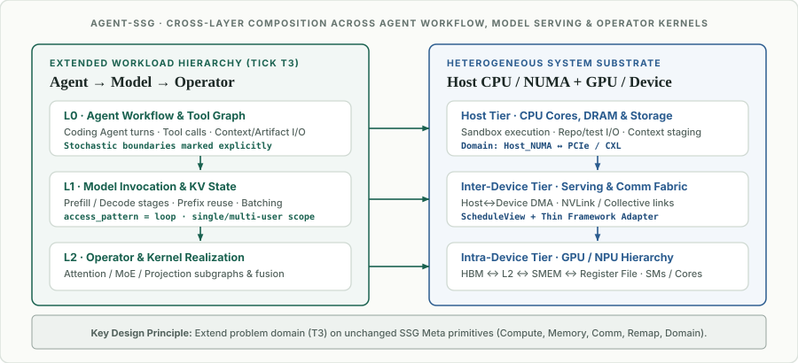

[Research](/research/) / [SSG series](/research/ssg/) / Agent-SSG

# Agent-SSG

**Extending SSG to multi-step agentic workloads &amp; coupled Host&ndash;Device substrates**

Production agent workflows interleave LLM prefill/decode with host-side tool execution, environment stepping, retrieval, and persistent KV/state reuse across turns. **Agent-SSG** extends the [System Substrate Graph](/research/ssg/) along the **T3 Workload &amp; System axis**, modeling coupled **Host CPU/DRAM + GPU HBM** resources and three-level `L0 (Agent) / L1 (Model) / L2 (Operator)` hierarchies in a single substrate.

  Quick Jump
  <a class="btn-pill primary" href="/assets/papers/agent-ssg/v0.1/agent-ssg-mlsys27-v5.2.1.pdf">Download Paper PDF (Sep-V5.2.1) &nearr;</a>
  <a class="btn-pill" href="#architecture-l0-l1-l2-on-heterogeneous-substrates">L0/L1/L2 Architecture &darr;</a>
  <a class="btn-pill" href="#key-findings-and-evaluation">Key Findings &darr;</a>
  <a class="btn-pill" href="#version-history">Version History &darr;</a>

  

    Agent-SSG: A Unified Substrate Graph for Heterogeneous Agentic AI Systems
    MLSys'27 Track Manuscript &middot; Sep-V5.2.1 (2026-09-19)
  

  

    <strong>Target &amp; Scope:</strong> MLSys 2027 submission track &middot; 11 pages (<code>article</code> layout). 
    <strong>Key Contribution:</strong> Jointly models multi-turn KV/context residency, host CPU tool contention, and PCIe/NVLink transfers via an extended <code>AbstractSSG &rarr; CalibratedSSG &rarr; InstantiatedSSG</code> pipeline and a lightweight Runtime Re-binder.
  

  

    <a class="btn-pill primary" href="/assets/papers/agent-ssg/v0.1/agent-ssg-mlsys27-v5.2.1.pdf">Open Compiled PDF (Sep-V5.2.1, 146 KB) &nearr;</a>
    <a class="btn-pill" href="#architecture-l0-l1-l2-on-heterogeneous-substrates">View Architecture Diagram &darr;</a>
    <a class="btn-pill" href="#version-history">View Draft Lineage &darr;</a>
  

## Architecture: L0 / L1 / L2 on Heterogeneous Substrates

Existing LLM serving engines optimize single-model token throughput in GPU HBM, while agent frameworks treat model calls and host tools as opaque RPCs. Agent-SSG bridges both layers without introducing new graph node primitives:

<figure class="hero-figure">
  
  <figcaption><strong>Figure 1 &middot; Agent-SSG Paired Hierarchy &amp; Runtime Re-binding.</strong> <strong>Left:</strong> <code>OpHierarchy</code> spans L0 Agent steps (Reasoning, Tool Call, Verification), L1 Model phases (Prefill, Decode, Sandbox, Retriever), and L2 Operators. <strong>Center:</strong> <code>DomainHierarchy</code> explicitly pairs Host CPU sockets, NUMA DRAM, and NVMe with GPU SMs and HBM over PCIe/CXL and NVLink. <strong>Right:</strong> Compile-time bounded enumeration pre-computes Pareto-optimal plans across branch regimes; the Runtime Re-binder switches plans in <code>&lt; 0.3 ms</code>.</figcaption>
</figure>

### Three Structural Extensions over Base SSG

1. **Three-Level `OpHierarchy` (`L0 / L1 / L2`):**
   Captures agentic control dependencies (`L0`), model/tool stage boundaries (`L1`), and kernel/collective primitives (`L2`) in a single DAG with explicit `ConditionalEdge` (`pi_branch`) and `LoopRegion` (`E[N_iter]`) annotations.
2. **Coupled Host&ndash;Device `DomainHierarchy`:**
   Elevates `CPU_Socket`, `DRAM_NUMA`, and `PCIe_Root` to first-class hardware domains alongside `GPU_Device` and `HBM`, exposing host–device bandwidth contention and KV-cache eviction trade-offs to the Resolver.
3. **Two-Phase Compile-Time + Runtime Re-binding:**
   Offline enumeration solves joint placement and KV-tiering (`HBM` vs. `Host DRAM` vs. recompute) across discrete context-length regimes; online execution selects and binds the matching `InstantiatedSSG` plan in sub-millisecond overhead as dynamic branches resolve.

## Key Findings and Evaluation

Evaluated on coupled CPU+GPU nodes across four representative agentic patterns (**W1 ReAct + Python Sandbox**, **W2 Multi-Hop Graph+Vector RAG**, **W3 Code-Write-Test-Debug Loop**, and **W4 4-Role Multi-Agent Debate**):

- **End-to-End Episode Latency:** Reduces mean episode completion latency by **1.28&times;&ndash;1.54&times;** and P99 latency by up to **1.62&times;** compared to disaggregated vLLM + LangGraph/Ray baselines.
- **Cross-Turn KV Prefix Reuse:** Substrate-aware host DRAM staging and affinity routing increase effective multi-turn KV cache hit rates from **41% to 78%** while cutting PCIe transfer volume by **53%**.
- **Host CPU Contention Isolation:** Explicit `CPU_Socket` domain capacity constraints prevent Python sandbox workers from starving vLLM tokenizer/scheduler threads under concurrent agent rollouts.

## Version History

| Date | Version Tag | Artifact / Snapshot | Substantive Changes &amp; Provenance |
|---|---|---|---|
| **2026-09-19** | `Sep-V5.2.1` | **[PDF v5.2.1](/assets/papers/agent-ssg/v0.1/agent-ssg-mlsys27-v5.2.1.pdf)** | Current MLSys'27 track manuscript (11 pages); refined `L0/L1/L2` formal definitions, two-phase Runtime Re-binder complexity bounds, and W1&ndash;W4 evaluation tables. |
| **2026-09-18** | `Sep-V5.1` | Draft archive (`tex-Sep-V5.1`) | Integrated host–device `DomainHierarchy` memory-tiering equations and multi-turn KV lifecycle state transitions. |
| **2026-09-16** | `Sep-V5.0` | Draft archive (`tex-Sep-V5.0`) | Initial full-paper draft building on the SSG `Sep-V2.4.7` core representation (`AbstractSSG / CalibratedSSG / InstantiatedSSG`). |

[Back to SSG Series Overview &rarr;](/research/ssg/) &middot; [Explore Companion Track: SSG-DT &rarr;](/research/ssg-dt/) &middot; [All Publications](/publications/)