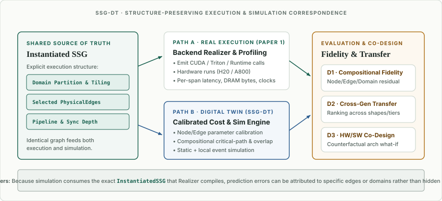

[Research](/research/) / [SSG series](/research/ssg/) / SSG-DT

# SSG-DT: Execution Generation and Digital Twins

**Rule-Guided Cross-Scale Execution Generation and Structure-Preserving Digital Twins**

SSG-DT asks whether the same hierarchical execution representation can support **generating legal alternatives, realizing them on hardware, attributing measurements, and predicting unmeasured alternatives**. Its target spans operators and model graphs through training, inference, and RL over chip, scale-up, and scale-out systems. Actual claims remain bounded to implemented and measured paths.

**Current working draft:** `2026.10.4.3.1` · updated 28 October 2026. **Status:** architecture, hypotheses, and evaluation protocol; no measured SSG-DT results are claimed. Base-SSG execution measurements provide starting evidence, rather than digital-twin validation. Agent/tool execution and Agent-level DT are assigned to separate Agent-SSG and future Agent-SSG-DT work.

<a class="btn-pill primary" href="#execution-and-simulation-structural-correspondence">Twin Contract</a>
<a class="btn-pill" href="#rule-guided-execution-population">Execution Population</a>
<a class="btn-pill" href="#three-execution-frontiers">Execution Frontiers</a>
<a class="btn-pill" href="#multi-fidelity-ladder-d1-d2-d3">Fidelity</a>
<a class="btn-pill" href="#roadmap-and-manuscript-status">Status</a>

## Execution and Simulation Structural Correspondence

<figure class="hero-figure">

<figcaption><strong>Shared plan identity.</strong> Execution artifacts, observations, and predictions refer to the same selected InstantiatedSSG. Declared aggregation is allowed with a mapping back to relevant events; strict graph isomorphism and cycle accuracy are not assumed.</figcaption>
</figure>

A proposed twin is `D_t = (I_σ, x_t, θ_t, O_t, V_t)`: the selected execution plan, measured or estimated live state, timing/resource parameters, attributed observations, and provenance/fidelity information. These are overlays on the existing SSG objects. **CalibratedSSG names the System representation; its presence does not establish that a performance predictor has been calibrated.**

| Contract | Required correspondence |
|---|---|
| Structural fidelity | Compute, Remap, Sync, resource bindings, and relevant dependencies remain attributable through prediction and execution |
| Trace consistency | Stable plan/artifact/region identifiers; distinguish queues, launches, device work, movement, and overlap |
| Calibration | Reproducible observation IDs, declared warm/cold conditions, and separate calibration/validation populations |
| Legality and support | Reject or flag queries without legal realizations, backend capabilities, or calibration support |
| Uncertainty | Report fidelity level, assumptions, interpolation/transfer status, and unresolved interference |

## Rule-Guided Execution Population

Starting from `AbstractSSG(W)` and target `CalibratedSSG(h)`, semantic decomposition/composition rules derive transformations `τ`; capability checks admit schedules `σ`; Instantiate produces CRS plans; Translate produces runnable artifacts and graph manifests. Lazy, bounded generation records rule IDs, parameters, and pruning decisions so another run can reconstruct the candidate population.

The proposed evidence ladder is:

**Representable → Semantically legal → Capability-feasible → Generated → Translated → Correct → Run → Attributed → Predictable / Selectable.**

Counts and attrition at each stage matter. A broad legal space does not establish a broad code generator, and a correct generated variant need not be faster. Numerical equivalence must specify tolerances and any allowed reduction reassociation.

The minimal twin loop is **generate → compile/execute → observe → calibrate → query a held-out variant → verify**. Statistical models can rank candidates or estimate residuals within this loop; they do not replace the execution and observation contracts.

## Three Execution Frontiers

The latest draft distinguishes three properties of a chosen realization:

| Frontier | Boundary being selected | Example consequence |
|---|---|---|
| **Dispatch** | External kernel or engine invocation | Launch/submit overhead and allocation lifetime |
| **Scheduling** | Smallest independently schedulable tile, chunk, core, or stream task | Available concurrency and blocked-resource occupancy |
| **Materialization** | State that must be committed before a consumer proceeds | Memory traffic, residency, and producer–consumer visibility |

These are derived analysis coordinates, rather than new top-level SSG primitives. Static fusion, tile pipelines, independent kernels, and persistent task schedulers can place the boundaries differently. A retained kernel boundary can enable specialized launches or overlap; removing it can introduce spills or hold resources while stalled. The research question concerns where those crossovers occur across supported variants.

The 28 October literature update uses *One Megakernel is Not Enough* as a close comparator for region/tile/event refinement and publication-aware boundary selection. Such refinement and profile-based fusion selection alone are not SSG-DT's distinguishing claim.

## Multi-Fidelity Ladder: D1 / D2 / D3

The existing diagram's D1/D2/D3 labels are retained as planning shorthand. The current draft specifies fidelity through the following operational contracts, rather than an achieved speed or accuracy target:

| Planning level | Current contract | Verification needed |
|---|---|---|
| D1 · Leaf / coarse cost | Measured compiled variants, lookup/analytical/interpolated estimates at declared shapes | Reference timing and resource footprint under stated conditions |
| D2 · Dependency replay | Event readiness, launches, data movement, Sync, resource contention, and overlap | Held-out schedule ranking and trace correspondence |
| D3 · Stateful counterfactuals | Queues, shared resources, residency, and supported transitions | Validity range, uncertainty, and intervention-level fidelity |

A cold-start choice compares separately executable plans. A live switch additionally requires an implemented state-transition relation and explicit one-time transition cost. A representable switch is insufficient evidence that a safe runtime transition exists.

## Cross-Scale Attribution and Evaluation

Predicting each kernel accurately does not establish end-to-end fidelity: queueing, batching, overlap, and contention change how local costs compose. The proposed test compares **predicted and observed effects of a held-out intervention**, including critical-path and bottleneck changes, rather than multiplying local speedups.

Evaluation should report absolute error, ranking regret, selected-plan performance, memory/movement/Sync attribution, and generation coverage. Whole-graph comparisons include launch, allocation, fallback islands, framework conversions, and numerical correctness. Cross-hardware claims require matching physical workloads on a distinct accelerator family; documented architecture contrasts remain separate from measured portability.

Cyclotron informs the logical-communication versus physical-event boundary; Primus Projection informs measurement/projection/search comparisons. Compiler and graph systems such as AKG, TVM, IREE, XLA, Korch, Welder, and Mirage are substantive prior work. Their roles here follow the draft's positioning and do not imply implemented integrations.

## Roadmap and Manuscript Status

SSG-DT occupies **Operator + Trainfer × Performance Prototype** in the [SSG research space](/research/ssg/#ssg-3d-research-space). Initial evidence can come from a bounded H20 operator-to-model path; cross-architecture and scale-out/RL claims require their own realizations and observations. The future Agent-SSG-DT depends on both this twin machinery and actual Agent-SSG execution support.

| Snapshot | Development |
|---|---|
| `2026.10.4.3.1` · 28 October | Megakernel boundary selection, region/tile/event refinement, physical resource lifetime and publication constraints |
| `2026.10.3.1.1` · 19 October | Cyclotron communication refinement; Primus measurement/projection/search boundary |
| Earlier October drafts | Rule-guided generation, cross-hardware realization, physical attribution, and Operator/Trainfer DT scope |

[SSG](/research/ssg/) · [Agent-SSG](/research/agent-ssg/) · [Three Models](/research/three-models/)
