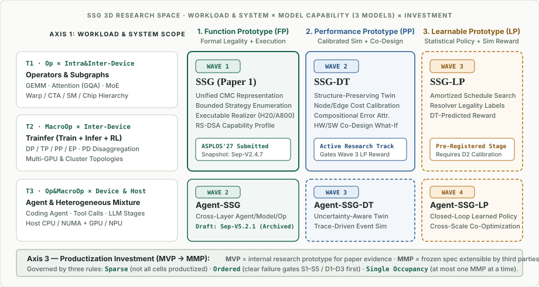
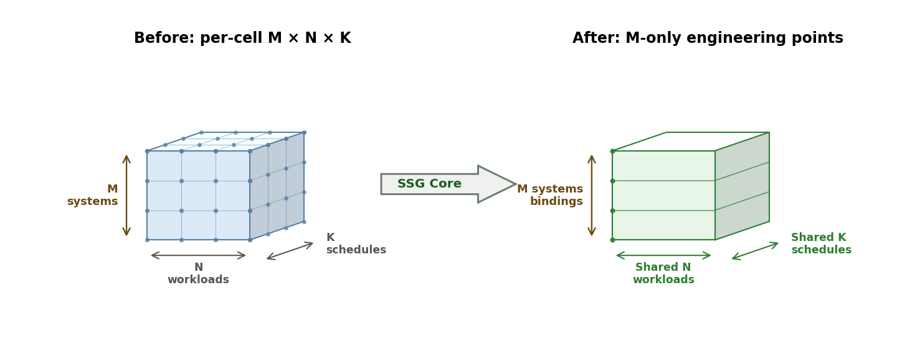

[Research](/research/) / SSG series

# System Substrate Graph (SSG)

**Modeling the AI computing execution world &middot; Unified Workload &times; System &times; Schedule representation**

SSG investigates how a single substrate graph built from **Compute, Memory, and Communication (CMC)** can represent, enumerate, and realize legal execution strategies across intra-device kernels (Warp / CTA / SM) and inter-device distributed workloads (DP / TP / PP / EP).

  Quick Jump
  <a class="btn-pill primary" href="/assets/papers/ssg/v0.1/ssg-asplos27-v2.4.7.pdf">Paper PDF &nearr;</a>
  <a class="btn-pill" href="#measured-results">Measured Results &darr;</a>
  <a class="btn-pill" href="#ssg-3d-research-space">3D Research Space &darr;</a>
  <a class="btn-pill" href="#core-architecture-abstract-calibrated-and-instantiated-ssg">Core Architecture &darr;</a>
  <a class="btn-pill" href="#manuscripts-and-artifacts">Manuscript &amp; Abstract &darr;</a>
  <a class="btn-pill" href="#version-history">Version History &darr;</a>

  

    System Substrate Graph: One Cross-Scale Representation of Workload, System, and Schedule for AI Computing
    Submitted manuscript &middot; September 2026
  

  

    <strong>Format:</strong> 13 pages, ACM format, anonymized for review. 
    <strong>Contributions:</strong> (1) paired Op and System hierarchies over shared Compute&ndash;Memory&ndash;Communication, bound by a Parallel &times; Pipeline schedule and materialized as Compute&ndash;Remap&ndash;Sync; (2) a Build / Traverse / Translate architecture that separates graph transformation from strategy mapping; (3) a three-group evaluation on H20 and 8&times;A800 that reports representation, legality, correctness, and measured performance as separate evidence states.
  

  

    <a class="btn-pill primary" href="/assets/papers/ssg/v0.1/ssg-asplos27-v2.4.7.pdf">PDF (485 KB) &nearr;</a>
    <a class="btn-pill" href="#measured-results">Measured results &darr;</a>
    <a class="btn-pill" href="#version-history">Versions &darr;</a>
  

## SSG 3D Research Space

Rather than conflating kernel codegen, distributed scheduling, performance simulation, and agent orchestration into a single monolithic claim, the SSG program is organized as a **three-axis planning cube** with explicit wave gates:

<figure class="hero-figure">
  
  <figcaption><strong>Figure 1 &middot; SSG 3D Research Space &amp; Cumulative Wave Staging.</strong> <strong>Axis 1 (Workload &amp; System):</strong> T1 (Operators &amp; Subgraphs) &rarr; T2 (Trainfer = Training + Inference + RL) &rarr; T3 (Heterogeneous Agent + Host/Device mixtures). <strong>Axis 2 (Model Capability):</strong> Function Prototype (FP) &rarr; Performance Prototype (PP / <a href="/research/ssg-dt/">SSG-DT</a>) &rarr; Learnable Prototype (LP). <strong>Axis 3 (Investment):</strong> MVP &rarr; MMP engineering maturity within each scope/capability cell.</figcaption>
</figure>

## Core Architecture: Abstract, Calibrated and Instantiated SSG

Between open frontend IRs (PyTorch FX, ONNX, Triton, StableHLO) and closed vendor backends, SSG provides a hardware-independent **Schedule &amp; Resource Orchestration IR** built around three graph objects and a **Build&ndash;Traverse&ndash;Translate (BTT)** pipeline:

  <figure class="hero-figure">
    
    <figcaption><strong>Figure 2 &middot; Factorizing the M &times; N &times; K Space (Paper &sect;1).</strong> Instead of hand-crafting per-cell implementations for every workload, schedule, and hardware target, SSG shares a unified Workload/Schedule substrate across system bindings.</figcaption>
  </figure>
  <figure class="hero-figure">
    
    <figcaption><strong>Figure 3 &middot; Paired Workload &amp; System Hierarchies (Paper &sect;3).</strong> Workload data tiles (<code>DT</code>) and intermediate memories (<code>IM</code>) align structurally with hardware compute cores (<code>CC</code>), memory tiers (<code>Mem</code>), and candidate communication edges.</figcaption>
  </figure>

| Stage | Graph Object | Structural Elements | Role in Pipeline |
|---|---|---|---|
| **1. Software Workload** | `AbstractSSG` | `ComputeNode`, `MemoryNode` (GM anchors), `CommunicationEdge` | Canonical workload IR imported via `cg2ssg` across operators and MacroOps |
| **2. Hardware System** | `CalibratedSSG` (`Substrate`) | `Node` (compute/memory), `Domain` tree (`parent__child`), candidate `PhysicalEdge` | Encodes hardware hierarchy capacities, legal communication primitives (`lsu`, `cp.async`, `tma`, `nvlink`), and sync scopes |
| **3. SW &times; HW Binding** | `InstantiatedSSG` | Committed per-Domain tiling, placement, pipeline stages, and selected `edge_id`s | Verified legal execution plan consumed by the **Backend Realizer** (or **[SSG-DT](/research/ssg-dt/)** simulator) |

### Execution Semantics: CMC to CRS

**CMC (Compute–Memory–Communication)** describes workload/system structure before a mapping is chosen. **CRS (Compute–Remap–Sync)** describes the selected execution. The relationship is not a one-to-one renaming: a logical communication relation can become a local layout change, a transfer, a collective, or no materialized transfer when a realization removes the boundary.

`AbstractSSG(W)` and `CalibratedSSG(S)` are independent Build outputs. Traverse binds them with a Schedule; Instantiate records that mapping; Translate produces a supported backend artifact. The System object's historical name, CalibratedSSG, does not imply digital-twin timing calibration.

### Schedule as Parallel × Pipeline

The lean-framing working draft organizes Schedule into **Parallel** (partitioning, replication, ownership, and placement) and **Pipeline** (staging, ordering, buffering, and overlap). DP/TP/EP/FSDP and PP/1F1B are specific projections or compositions within those families. The schematic `M × N × K` authoring surface motivates reuse across hardware, workloads, and strategies; it is not a proved asymptotic complexity reduction.

Compute tiling semantics separate **Input Partializability, Output Finalization, and Ordering Constraint (IPOFOC)**. Compute–compute fusion needs compatible partitions, finalization, and ordering. Compute–Remap fusion additionally depends on the selected execution and target capabilities. Remap requirements can originate in workload communication, hardware layout adaptation, or mapping/execution boundaries.

### Research Space and Manuscript Boundaries

| Coupled scope | Functional | Performance | Learnable |
|---|---|---|---|
| Operator | Base SSG realization | SSG-DT operator entry case | Future learned operator/schedule search |
| Trainfer (training/inference/RL) | Supported SSG framework paths | SSG-DT cross-scale validation target | Future execution decision models |
| Agent | Agent-SSG execution proposal | Future Agent-SSG-DT | Future Agent-level learning |

Each cell can advance from MVP to MMP. This is a portfolio of research/engineering targets, not eighteen established capabilities or separate paper requirements. Agent-SSG and SSG-DT extend different axes; Agent-SSG-DT would depend on both. TSG is a parallel research series outside this cube.

### Evaluation Groups in Paper 1 (`Sep-V2.4.7`)

  <figure class="hero-figure">
    
    <figcaption><strong>Figure 4 &middot; Group 1: Operator Strategy Enumeration &amp; Legality.</strong> Bounded enumeration projects legal candidate strategies across Domain boundaries and memory-movement primitives on NVIDIA H20.</figcaption>
  </figure>
  <figure class="hero-figure">
    
    <figcaption><strong>Figure 5 &middot; Group 3: Subgraph Realization &amp; Fusion Ladder.</strong> Progressive cross-operator realization (QKV projection &rarr; RMSNorm/RoPE &rarr; Attention) with numerical correctness verification.</figcaption>
  </figure>

- **Group 1 (Intra-Device Operators):** Bounded enumeration, legality filtering, and CUDA/Triton realization for GEMM on NVIDIA H20.
- **Group 2 (Trainfer framework experiments):** The attached submission reports selected DP/TP/PP and prefill/decode studies on A800. Representational coverage of training/inference/RL does not establish every scale-out or RL execution path as physically validated.
- **Group 3 (Composite Model Subgraphs):** Multi-operator GQA producer/consumer chains and MoE routing/expert execution paths, plus **RS-DSA** capability-profile discussion (Appendix B), distinct from measured cross-hardware portability.

## Measured Results

Numbers from the submitted manuscript (&sect;5&ndash;7). They cover single-node H20 and 8&times;A800 configurations only.

| Scope | Result | How to read it |
|---|---|---|
| **Operator: GEMM (H20)** | 2,892&ndash;2,988 legal candidates per shape; generated kernels reach **49.6&ndash;110.1% of cuBLAS** on nine FP16 shapes, elementwise identical to the reference | Best-in-pool per shape, not automatic selection |
| **Operator: correctness funnel** | 194 of 482 measured variants (40.2%) fail correctness; 77 pipelined variants fail while their 77 parallel pairs pass | Legality and correctness are reported as separate stages |
| **Operator: row reduction** | **1.09&ndash;2.79&times;** CUB throughput on all 66 declared cases | Mostly from one fused launch vs. two library launches |
| **Framework: inference (8&times;A800)** | Qwen3-8B at offered load 512: DP4&times;TP2 reaches 7,781 tok/s, **+57% over TP8** | The best binding moves with load; one Schedule vocabulary covers DP/TP/PP |
| **Framework: transport** | PP2&times;TP4 vs. TP8 ratio spans 0.59&ndash;1.03 on NVLink and 0.86&ndash;3.40 with P2P disabled (Qwen3-8B) | The preferred binding also moves with the System input |
| **Framework: training / RL** | SFT scales 1.316&times; from 4 to 8 devices (65.8% efficiency); two RL resource partitions give 13.05 s and 22.32 s step times | Plans emitted to framework-native execution |
| **Model path: Qwen3 MoE** | A mixed execution configuration records 205.0 tok/s, 95.6% of framework decode throughput, with substantially slower prefill | Graph capture records 48 fallbacks, so decode replay can use the framework implementation. This measures the mixed configuration, not isolated SSG-router throughput or an end-to-end speedup |

## Manuscripts and Artifacts

### *System Substrate Graph: One Cross-Scale Representation of Workload, System, and Schedule for AI Computing*

- **Status:** submitted manuscript, September 2026 (internal version `Sep-V2.4.7`).
- **PDF:** **[ssg-asplos27-v2.4.7.pdf](/assets/papers/ssg/v0.1/ssg-asplos27-v2.4.7.pdf)** (13 pages, anonymized).
- **Claim Modality:** *Attainability and structural coverage*, not universal superiority over hand-tuned vendor libraries. Calibrated runtime prediction and hardware co-design are explicitly scoped to **[SSG-DT](/research/ssg-dt/)**.

## Version History

| Date | Version Tag | Artifact / Snapshot | Substantive Changes &amp; Provenance |
|---|---|---|---|
| **2026-09-14** | `Sep-V2.4.7` | **[PDF](/assets/papers/ssg/v0.1/ssg-asplos27-v2.4.7.pdf)** | Submitted version: revised introduction, G1&ndash;G3 measured figures (H20 and A800), RS-DSA appendix. |
| **2026-08-29** | `Aug-V4.3.2` | Internal draft | Terminology alignment, wording audit of unmeasured claims, paired Workload&ndash;System diagrams. |
| **2026-08-18** | `Aug-V3.0` | Internal draft | First measured experiment figures; unified `AbstractSSG / CalibratedSSG / InstantiatedSSG` terminology. |
| **2026-08-17** | `Aug-V2.4.3` | Internal draft | First complete ACM-format build; related work including TAOT, CUDA Tile IR, and CuTe. |
| **2026-08-06** | `Roadmap v1.5.2` | Research plan | Three-axis research space (scope &times; model capability &times; engineering maturity), staged waves, measurement kept separate from simulation. |

[Explore Companion Track: Agent-SSG &rarr;](/research/agent-ssg/) &middot; [Explore Companion Track: SSG-DT &rarr;](/research/ssg-dt/) &middot; [All Publications](/publications/)
