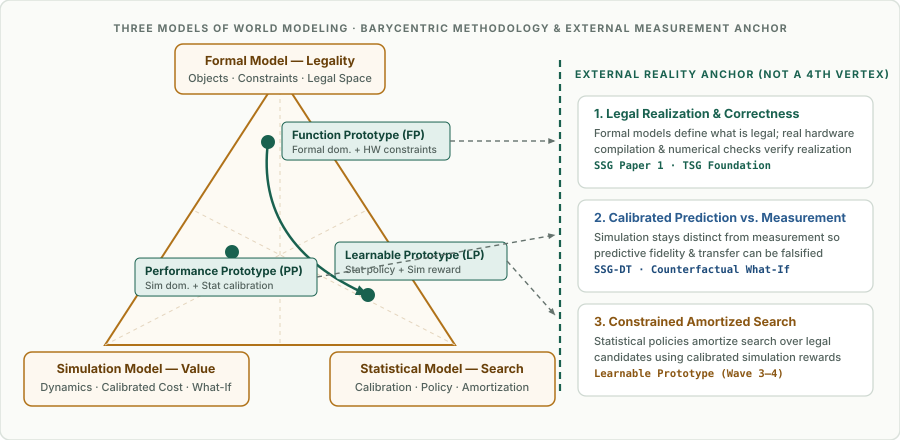

[Research](/research/) / Methodology

# Three Models of World Modeling

**Formal &middot; Simulation &middot; Statistical &mdash; anchored against external Measurement**

Three Models investigates how complementary modeling contracts can represent the same domain while maintaining distinct responsibilities and falsification criteria: **Formal decides what is legal, Simulation decides what is good, and Statistical decides how to find it.**

  On This Page
  <a class="btn-pill primary" href="#barycentric-prototypes-in-ssg-and-tsg">Barycentric Prototypes &darr;</a>
  <a class="btn-pill" href="#why-measurement-stays-outside-the-triangle">Measurement Anchor &darr;</a>
  <a class="btn-pill" href="#manuscripts-and-artifacts">Manuscripts &amp; Lineage &darr;</a>
  <a class="btn-pill" href="/research/ssg/">Series A: SSG &rarr;</a>
  <a class="btn-pill" href="/research/tsg/">Series B: TSG &rarr;</a>

<figure class="hero-figure">
  
  <figcaption><strong>Figure 1 &middot; Method Triangle &amp; External Reality Anchor.</strong> Rather than treating Formal, Simulation, and Statistical models as isolated silos, concrete engineering deliverables sit at interior barycentric points (Function Prototype &rarr; Performance Prototype &rarr; Learnable Prototype). Real-world measurement stands outside the triangle as the shared calibration and audit anchor.</figcaption>
</figure>

## Core Research Question

How can different modeling paradigms share the same domain objects and observations without blurring the boundary between **structural legality**, **mechanistic prediction**, **data-driven search**, and **real-world measurement**?

## Three Complementary Contracts

| Paradigm | Core Responsibility | Canonical Objects | Validation Criterion |
|---|---|---|---|
| **Formal Model** | **Legality &amp; Structure** | Graphs, types, constraints, admissible transformations (`R x T x C`) | Well-formedness, invariant preservation, compilability, bounded enumeration |
| **Simulation Model** | **Value &amp; Dynamics** | State transitions, critical paths, calibrated node/edge costs, counterfactuals | Compositional fidelity, ranking correlation, cross-generation transfer |
| **Statistical Model** | **Search &amp; Amortization** | Parameter estimators, residual attribution, learned scheduling policies | Sample efficiency, regret vs. exact/enumerated optima, generalization |
| *External Anchor* | **Empirical Reality** | Real hardware execution (H20/A800), trace logs, task evolution histories | Reproducible physical measurement (kept distinct from Simulation) |

## Barycentric Prototypes in SSG and TSG

In our research roadmap, a concrete system prototype is not a single vertex of the triangle&mdash;it is an **interior barycentric combination** over a shared representation:

1. **Function Prototype (FP) &mdash; Formal dominant, Sim auxiliary, Stat &approx; 0:**
   Establishes the unified representation (`AbstractSSG`, `CalibratedSSG`, `InstantiatedSSG` or `TSG` formalism), checks legality constraints, and proves executability through a Backend Realizer.
2. **Performance Prototype (PP / Digital Twin) &mdash; Simulation dominant, Stat auxiliary, Formal as substrate:**
   Calibrates node/edge parameters against measured runs, predicts cross-scale behavior compositionally, and supports counterfactual hardware/software co-design (**[SSG-DT](/research/ssg-dt/)**).
3. **Learnable Prototype (LP) &mdash; Statistical dominant, Sim as reward, Formal as hard constraint:**
   Trains amortized policies to emit legal transformation sequences without exhaustive search, using the Resolver for free legality labels and the calibrated Digital Twin for reward signals.

## Why Measurement Stays Outside the Triangle

A central methodological rule (formalized in **SSG Roadmap v1.5.2**) is that **Measurement is not folded into Simulation**. If real hardware measurement were treated as just another simulation vertex, the core scientific claim of a digital twin&mdash;*that calibrated prediction can replace costly measurement across a defined design space*&mdash;could not be stated or falsified. Keeping Measurement as an external reference line ensures every prototype stage has an explicit empirical audit gate.

## Manuscripts and Artifacts

Three Models serves as the overarching methodological foundation across our research workbench:

- **Integrated into SSG Research Roadmap (`v1.5.2`, Aug 2026):** Formalizes the `Formal x Sim x Stat` barycentric trajectory, the external Measurement reference line, and the FP &rarr; PP &rarr; LP prototype progression. See **[SSG Research Page](/research/ssg/) with direct PDF anchors**.
- **Applied in TSG Foundation (`Sep-V3.1.14`, Sep 2026):** Distinguishes formal task-graph representation (`G_T` and `Spec = R x T x C`) from runtime execution traces and empirical workbench evolution. See **[TSG Research Page](/research/tsg/) with direct PDF anchors**.

[Back to Research Overview](/research/) &middot; [Publications and Manuscripts](/publications/)