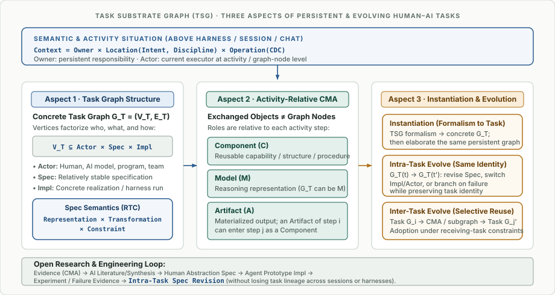

[Research](/research/) / TSG series

# Task Substrate Graph (TSG)

**Modeling the evolving human&ndash;AI task world &middot; Task graphs, CMA roles, and intra-/inter-task evolution**

As AI agents increasingly share long-horizon research, engineering, and creative work with humans, task structure is either left implicit in chat transcripts or locked inside rigid workflow engines. TSG provides a **substrate-level representation** that makes task situations, step specifications (`R x T x C`), activity-relative object roles (`CMA`), and revision/transfer evolution explicit without turning the representation into an authoritarian scheduler.

  Quick Jump
  <a class="btn-pill primary" href="/assets/papers/tsg/v0.1/tsg-preprint-v3.1.13.pdf">Download TSG Paper PDF (v3.1.13) &nearr;</a>
  <a class="btn-pill" href="/assets/papers/tsg/v0.1/tsg-preprint-v3.1.14-source.tar.gz">v3.1.14 Source (.tar.gz) &nearr;</a>
  <a class="btn-pill" href="#tsg-three-core-aspects">Three Core Aspects &darr;</a>
  <a class="btn-pill" href="#historical-lineage-tli-and-workbench-to-tsg">Historical Lineage &darr;</a>
  <a class="btn-pill" href="#version-history">Version History &darr;</a>

  

    Task Substrate Graph: Representing Evolving Human&ndash;AI Tasks
    arXiv Preprint Track (Submission 8122073) &middot; Sep-V3.1.14 / PDF v3.1.13
  

  

    <strong>Scope &amp; Contribution:</strong> Formalizes the four-axis task context (<code>Owner &times; Actor &times; Location &times; CDC</code>), the task graph <code>G_T = (V_T, E_T)</code> with <code>Spec = R &times; T &times; C</code>, activity-relative <code>Component / Model / Artifact (CMA)</code> roles, and <code>Instantiation</code> + <code>Intra-Task</code> / <code>Inter-Task Evolve</code> across three concrete task traces. 
    <strong>Precursor Manuscripts:</strong> Incorporates and unifies earlier standalone formulations of <strong>TLI (Thought&ndash;Language Interface)</strong> and <strong>Personal Research &amp; Creation Workbench</strong>.
  

  

    <a class="btn-pill primary" href="/assets/papers/tsg/v0.1/tsg-preprint-v3.1.13.pdf">Open TSG Preprint PDF (Sep-V3.1.13, 132 KB) &nearr;</a>
    <a class="btn-pill" href="/assets/papers/tsg/v0.1/tsg-preprint-v3.1.14-source.tar.gz">Download Sep-V3.1.14 Source Archive (arXiv 8122073) &nearr;</a>
    <a class="btn-pill" href="/assets/papers/tsg/v0.1/tli-aug-v4.2.pdf">Precursor: TLI Paper PDF (Aug-V4.2) &nearr;</a>
    <a class="btn-pill" href="/assets/papers/tsg/v0.1/workbench-aug-v0.1.pdf">Precursor: Workbench Paper PDF (Aug-V0.1) &nearr;</a>
  

## TSG Three Core Aspects

To answer how open-ended human&ndash;AI tasks can be represented, revised, and reused without freezing exploration prematurely, TSG is organized around **three tightly coupled aspects**:

<figure class="hero-figure">
  
  <figcaption><strong>Figure 1 &middot; The Three Core Aspects of TSG.</strong> <strong>(1) Semantic Context &amp; Task Graph:</strong> situates activities in <code>Owner &times; Actor &times; Location(Intent, Discipline) &times; CDC</code> and decomposes work into nodes <code>V_T &sube; Actor &times; Spec(R, T, C) &times; Impl</code>. <strong>(2) Activity-Relative CMA Roles:</strong> distinguishes persistent object identity from contextual role (<code>Component</code> consumed, <code>Model</code> consulted, <code>Artifact</code> produced/modified). <strong>(3) Instantiation &amp; Evolution:</strong> separates routine step execution from identity-preserving <code>Intra-Task Evolve</code> and cross-task <code>Inter-Task Evolve</code>.</figcaption>
</figure>

### Aspect 1: Semantic Situation & Task Graph (`G_T`)

Every task is situated in a four-axis semantic context before graph decomposition:

- **Owner:** The agent (human, AI, or joint team) holding acceptance authority over task outcomes.
- **Actor:** The entity executing a specific activity (`Human`, `Agent`, or `Collaborative`).
- **Activity Location (`Intent x Discipline`):** Pairs motivational regime (`Emotion`, `Function`, `Performance`) with the domain coordinate (`Discipline`) where outputs accumulate.
- **Macro-Operation (`CDC`):** Classification into **Consume** (low-friction intake), **Digest** (compressing and structuring into reusable knowledge), and **Create** (producing new research, engineering, or creative outputs).

Within this context, a task graph `G_T = (V_T, E_T)` represents executable steps `v = (alpha, s, iota)` where `s = (R, T, C)` specifies **Representation**, **Transformation**, and **Constraints**, and `iota` binds the concrete prompt, script, or tool invocation.

### Aspect 2: Activity-Relative Object Roles (`CMA`)

Unlike static repository ontologies that permanently label a file as an "input" or "output", TSG separates **persistent object identity** from **activity-relative role** via a partial labeling `rho_T: V_T x O -> {C, M, A}`:

- **Component (`C`):** Material consumed or transformed by the step (`in`, `dep`).
- **Model (`M`):** Evaluative, predictive, or structural reference consulted without being consumed (`ref` &mdash; e.g., a formal grammar, calibrated simulator, or statistical policy).
- **Artifact (`A`):** Material output produced or updated by the step (`out`), which may subsequently become a `Component` or `Model` in downstream nodes.

### Aspect 3: Instantiation, Intra-Task Evolve & Inter-Task Evolve

- **Instantiation (`G_T -> G_T^(tau)`):** Binds abstract step specifications and object slots to concrete runtime handles during execution.
- **Intra-Task Evolve (`G_T^(t) -> G_T^(t+1)`):** Revises nodes, dependencies, or implementations when intermediate outputs fail constraints `C`, **while preserving task identity** and recording lineage (`supersedes`, `forked_from`, `merged_from`, `dissents_from`).
- **Inter-Task Evolve (`(G_{T1}, G_{T2}) -> G_{T'}`):** Transfers validated subgraphs (`Spec` skeletons) and distilled objects across distinct tasks without copying episodic execution noise.

## Historical Lineage: TLI and Workbench to TSG

The TSG manuscript synthesizes two earlier August 2026 research tracks into a single substrate formalism:

| Stage | Manuscript | Core Focus | How It Entered TSG |
|---|---|---|---|
| **Precursor A** | **[TLI: Thought&ndash;Language Interface](/assets/papers/tsg/v0.1/tli-aug-v4.2.pdf)** (`Aug-V4.2`) | Typed cognitive alignment (`Intent / Representation / Transformation / Constraint`) between human intent and LLM generation | Became the step-level `Spec = R x T x C` and `Intent(E x F x P)` coordinates inside `V_T` |
| **Precursor B** | **[Personal Research &amp; Creation Workbench](/assets/papers/tsg/v0.1/workbench-aug-v0.1.pdf)** (`Aug-V0.1`) | Auditable entity-relation hub (`IDO x outside`), multi-model panel deliberation (`dissents_from`), and human approval gates | Became the persistent object layer `O`, `CDC` macro-operations, and empirical case-study workbench |
| **Unified Track** | **[Task Substrate Graph (TSG)](/assets/papers/tsg/v0.1/tsg-preprint-v3.1.13.pdf)** (`Sep-V3.1.13` / `v3.1.14`) | Substrate-level task graph `G_T`, activity-relative `CMA` roles, and `Instantiation` / `Intra-Task` / `Inter-Task Evolve` | Unifies step-level cognitive specs and hub-level lifecycle into a general task-world substrate |

## Version History

| Date | Version Tag | Artifact / Snapshot | Substantive Changes &amp; Provenance |
|---|---|---|---|
| **2026-09-20** | `Sep-V3.1.14` | **[Source .tar.gz](/assets/papers/tsg/v0.1/tsg-preprint-v3.1.14-source.tar.gz)** (`5837bd8`) | Pure representation framing pass for arXiv submission `8122073`; reframed runtime protocols (`propose -> apply`, approval gates) as reference implementation choices rather than core graph semantics. |
| **2026-09-20** | `Sep-V3.1.13` | **[Compiled PDF](/assets/papers/tsg/v0.1/tsg-preprint-v3.1.13.pdf)** (`a69dc19`) | Restored TikZ architecture figures (`fig:overview`, `fig:evolve`), expanded 24-entry bibliography, and audited three end-to-end human&ndash;AI task traces (9 pages). |
| **2026-09-18** | `Sep-V3.1` | Draft milestone | Completed four-axis context (`Owner x Actor x Location x CDC`) and `CMA` role formalization across research, engineering, and creative tasks. |
| **2026-08-19** | `TLI Aug-V4.2` | **[Precursor PDF](/assets/papers/tsg/v0.1/tli-aug-v4.2.pdf)** (`3046fa0`) | 20-page Thought&ndash;Language Interface manuscript establishing `IRTC` cognitive alignment and multi-domain protocols. |
| **2026-08-19** | `Workbench Aug-V0.1` | **[Precursor PDF](/assets/papers/tsg/v0.1/workbench-aug-v0.1.pdf)** (`39bfcb5`) | 12-page Personal Research &amp; Creation Workbench manuscript detailing the 468-material / 140-theme Hub and Model Panel deliberation workflow. |

[Explore Companion Series: SSG &rarr;](/research/ssg/) &middot; [Explore Methodology: Three Models &rarr;](/research/three-models/) &middot; [All Publications](/publications/)